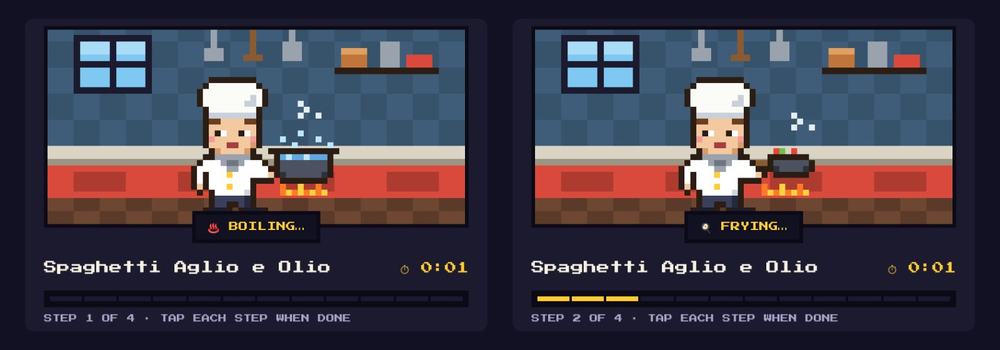

## What it is

Served Up is a cooking game for iOS and Android where the cooking is real. You pick a cuisine, open a recipe, and cook it in your own kitchen while the app walks you through each step with a checklist and timer. When you serve the dish, your chef earns XP and coins.

From there it plays like an RPG:
- **Coins** buy ingredients in the Market, and they stay in your pantry.
- **Levels** unlock harder recipes and new titles, from Dishwasher to Culinary Legend.
- **Kitchens:** you start with one cuisine and can open the others, nine in all (Italian, Japanese, Mexican, Indian, French, Persian, Chinese, Greek and Desserts), with 114 recipes between them.

Snap a photo of what you made and it goes into your Journal, with a 10-coin tip the first time.

## Why I built it

<!-- TODO: Write this in your own words. Were you trying to cook more, learn new cuisines, or make cooking at home feel less like a chore? -->

## Your chef acts out each step

The chef is 16-bit pixel art, drawn as crisp SVG squares. While you cook, it acts out whatever the current step involves, from seven actions: chopping, boiling, frying, baking, mixing, rolling and plating.

Nobody tagged 114 recipes by hand. The app reads each step and finds the first cooking verb in it. "Meanwhile, gently fry 4 thinly sliced garlic cloves" starts with *fry*, so the chef picks up a frying pan. Words only count as whole words (allowing *-s* and *-ing*), so an ingredient like "chopped tomatoes" or the word "chopsticks" doesn't set the chef chopping.

If a step uses a technique you don't know, tap **HOW?**, or switch to **Detailed** mode, for notes on how to dice, simmer, fold or blind-bake, and how to tell when it's done.

## Reasons to come back

- **Chef's Special:** one dish a day is worth double XP the first time you serve it.
- **First-cook bonus:** the first time you cook a dish pays 50% extra XP.
- **Streaks:** cooking on consecutive days pays 30, 75, 150 and 300 coins at 3, 7, 14 and 30 days.
- **Mastery:** cook a dish 1, 3 and 5 times for bronze, silver and gold medals.
- **Wardrobe:** spend coins on hats, coats, a mustache, wall tiles and kitchen decor, including a cat and a neon sign.
- **Trophies:** 21 of them, each one appearing on your kitchen counter.

Each level takes 40 XP more than the last, starting at 80, so early levels come quickly and later titles take real commitment.

## Built to stay on your phone

Everything is stored on the device. Photos are copied into the app's private storage so they survive the system clearing its cache, and nothing is uploaded. When you share a dish or your chef profile, the app makes an Instagram post (1080 × 1350) or story (1080 × 1920) on the phone and hands it to the share sheet, so you decide where it goes.

Under the hood it's Expo and React Native with Expo Router. The game rules (XP, titles, buying, cooking, streaks and mastery) sit in plain TypeScript functions, separate from the screens, and are covered by 21 tests.

## Built with Claude Code

<!-- TODO: The commit history shows the app was built in Claude Code sessions. Say as much or as little as you like: how you decided what to build, how you checked the recipes and technique notes, what surprised you. Delete this section if you'd rather not mention it. -->

## What's next

<!-- TODO: Plans? For example, an App Store or Play Store release, more kitchens, or sharing recipes with friends. -->
